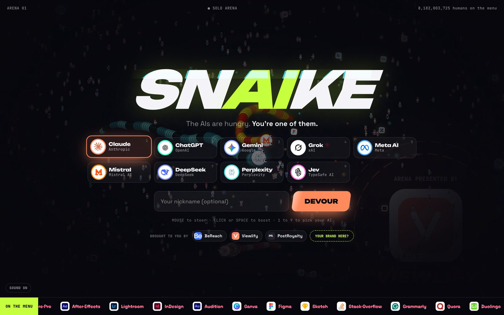
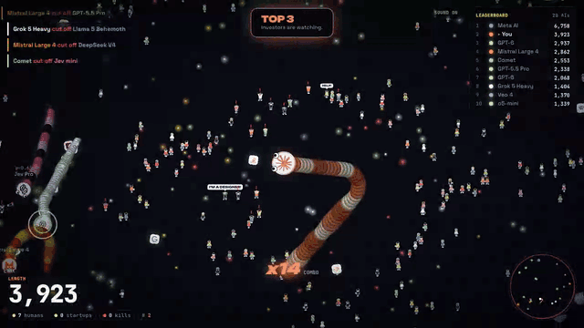
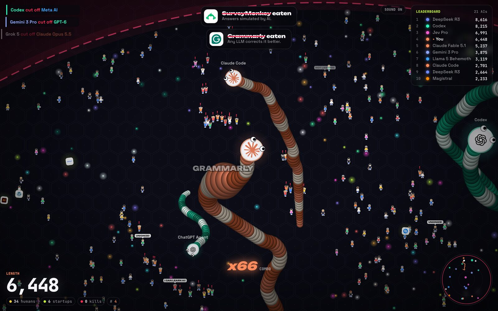
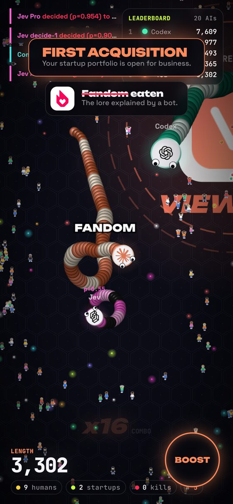
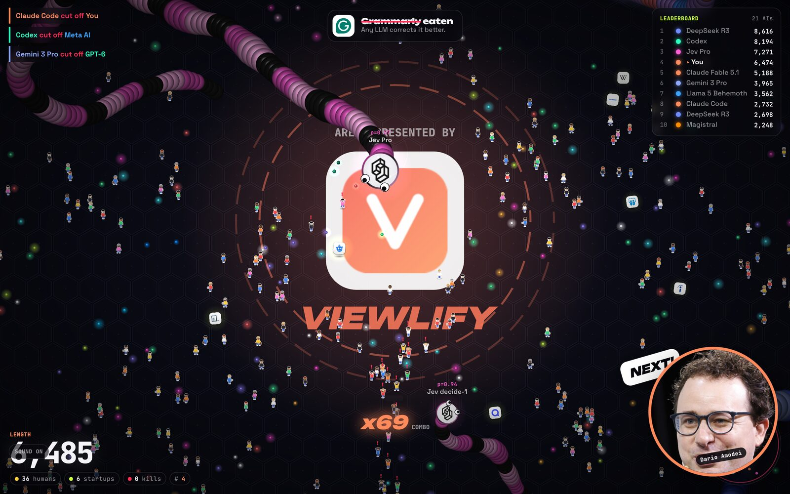

<p align="center">
  <a href="https://playsnaike.vercel.app/"></a>
</p>

<h1 align="center">SNAIKE</h1>

<p align="center">
  <b>The AIs are hungry. You're one of them.</b><br>
  A multiplayer snake game where Claude, ChatGPT, Gemini and Grok devour tiny panicking humans and the startups AI replaced.
</p>

<p align="center">
  <a href="https://playsnaike.vercel.app/"><b>▶ Play now in your browser</b></a> ·
  <a href="https://playsnaike.vercel.app/advertise.html">Put your brand in the arena</a>
</p>

<p align="center">
  
</p>

## What is it

Pick your AI, steer with the mouse, boost with a click. Eat humans to grow. Swallow app icons (Photoshop, Stack Overflow, Grammarly, Fiverr…) to build your acquisition portfolio. Cut other AIs off to eat what's left of them.

- **9 playable AIs**: Claude, ChatGPT, Gemini, Grok, Meta AI, Mistral, DeepSeek, Perplexity and Jev, each with its own colors and bot models (GPT-6, Claude Code, Gemini Flash, Jev decide-1…).
- **74 startups to acquire**, each with its own epitaph when you eat it: *"Grammarly eaten. Any LLM corrects it better."*
- **Humans that panic**: they run, scream "MY JOB!" and "I CAN LEARN AI!", and the ones you swallow escape when you die.
- **Tech CEOs pop up** Mortal Kombat style when you kill, die or take the lead.
- **Always a full arena**: real players take the seats of bots, bots fill the empty ones. No waiting room, ever.
- **Works everywhere**: desktop and mobile, 60 fps, no install, no account.

<table>
  <tr>
    <td width="68%" valign="top"></td>
    <td width="32%" valign="top"></td>
  </tr>
</table>

## Advertise in the arena

Brands can sponsor the game: a logo in the menu, a card on the game over screen, or a giant logo in the center of the arena. Payment and setup are automatic, and every sponsor gets a private page with live views and clicks.

<p align="center">
  
</p>

From $19 for 30 days: [playsnaike.vercel.app/advertise.html](https://playsnaike.vercel.app/advertise.html)

## Run it locally

```bash
npm install
npm run server   # game server on :5289
npm run dev      # client on :5173, connects to the server above
```

Add `?solo` to the URL to play offline against bots only.

Controls: mouse to steer, click or Space to boost. On mobile: drag to steer, BOOST button or a second finger to boost.

## How it works

- **No game engine.** Canvas 2D with pre-rendered sprites, sounds synthesized live with WebAudio, Vite + TypeScript.
- **One simulation, two places.** `src/game/world.ts` runs the whole arena (snakes, bots, humans, startups). It runs in the browser in solo mode and on the server in multiplayer.
- **Server.** `server/index.ts`, Node + WebSocket: arenas of up to 40 players simulated at 60 Hz, 30 snapshots per second. Each player only receives what's near them, in a compact binary format (`src/net/protocol.ts`), about 20 to 30 KB/s.
- **Smooth client.** `src/net/networld.ts` extrapolates between snapshots and corrects softly, so remote snakes stay as smooth as in solo.
- **Sponsors.** `server/sponsors.ts`: Stripe Checkout, view and click counting per placement, private stats links.

Deploy: the client is static (`npx vite build`). The live server runs for free on Cloudflare Workers + Durable Objects (`cf/worker.ts`, one Durable Object per arena, `npm run deploy:cf`). The same arena code also runs as a plain Node process (`npm run build:server && npm start`, see `Dockerfile` and `fly.toml`).

## Credits

Code: MIT. Logos come from [svgl](https://svgl.app) and [Simple Icons](https://simpleicons.org), CEO photos from Wikimedia Commons (see `public/heads/CREDITS.md`). All trademarks and logos belong to their owners. SNAIKE is a parody game, not affiliated with or endorsed by any company shown.
